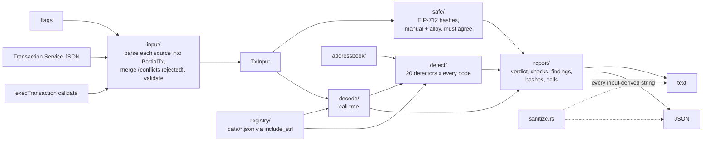

# Architecture

One package with a library and a binary ([ADR 0003](adr/0003-single-package-library-and-binary.md)).
`src/main.rs` parses arguments, reads files and stdin with size limits, calls
the library and sets the exit code. Everything else is in the library, and no
module performs network I/O ([ADR 0002](adr/0002-offline-by-construction.md)).



## Modules

| Module | Responsibility |
|---|---|
| `input/` | Strict parsers per field (`fields.rs`); JSON input with duplicate-key rejection (`json.rs`); `execTransaction` decoding (`exec.rs`); merging sources and applying defaults (`mod.rs`). |
| `safe/` | `SafeVersion`, `Operation`, `SafeTx`, `SafeAccount`; the hand-written EIP-712 encoder (`hash.rs`) and the alloy one (`eip712.rs`), compared on every call ([ADR 0005](adr/0005-dual-hashing-and-supported-versions.md)). |
| `registry/` | Embedded tables parsed once with `LazyLock`: official Safe contracts by `(chain, address)`, chain names, tokens, Permit2 ([ADR 0007](adr/0007-embedded-registry.md)). |
| `decode/` | Known functions decoded with `sol!` (`functions.rs`), strict `MultiSend` unpacking (`multisend.rs`), verified-vs-inferred semantics (`semantics.rs`, [ADR 0006](adr/0006-verified-and-inferred-semantics.md)), user ABIs (`user_abi.rs`), the call tree (`mod.rs`). |
| `addressbook/` | The user's named addresses and look-alike detection. |
| `detect/` | `Severity`, `Finding`, `Context`, the `Detector` enum and one file per detector, each with its tests. |
| `report/` | `analyse()` runs a command; text and JSON renderers; signature classification; exit codes. |
| `sanitize.rs` | Neutralises control, bidi and invisible characters in input-derived text. |
| `units.rs` | Exact decimal formatting of integer amounts. |

## The call tree

```rust
pub struct CallNode {
    pub path: CallPath,        // root, batch[2], batch[2] > nested, ...
    pub executor: Address,     // whose context the call runs in
    pub to: Address,
    pub value: U256,
    pub operation: Operation,
    pub data: Bytes,
    pub decoded: DecodedCall,
}

pub enum DecodedCall {
    Empty,                                   // no calldata
    Known { call: KnownCall, semantics },    // a known function, typed arguments
    User { call: UserCall },                 // decoded with a user ABI
    Batch { semantics, call_only, items },   // multiSend: one child per entry
    Nested { call, semantics, inner },       // execTransaction to another Safe
    Unknown { selector },
    Malformed { function, reason },
    TooDeep,                                 // beyond MAX_DEPTH (4)
}
```

The executor matters: a `multiSend` delegatecalled runs its entries as the
Safe; called normally, as the `MultiSend` contract; the inner transaction of a
nested `execTransaction` runs as the inner Safe. Semantics are decided against
the executor (an administrative call is verified only when sent to the Safe
that executes it).

`CallNode::nodes()` returns every node, parents first. `detect::run` applies
every detector to every node, and findings carry the node's path.

## Adding a detector

1. Specify it in [docs/detectors/CATALOG.md](detectors/CATALOG.md) and write
   `docs/detectors/<ID>.md` (what, why, example, incidents, false positives).
2. Add `src/detect/<name>.rs` with `pub const ID` and
   `pub fn check(ctx: &Context<'_>, node: &CallNode) -> Vec<Finding>`, plus
   tests for firing, not firing, inside a batch or nested transaction, and
   value edges. No I/O.
3. Add a variant to `Detector`, to `Detector::ALL`, and an arm to `meta`,
   `documentation` and `check` in `src/detect/mod.rs`. The compiler points at
   every `match` that needs it.
4. Add the row to the README table (a test compares it with the code) and
   review the snapshot in `tests/snapshots/` (`cargo insta review`).

## Adding a Safe version

1. Read the new version's `SAFE_TX_TYPEHASH` and `DOMAIN_SEPARATOR_TYPEHASH`
   (and how they are encoded) in the contract source; record them in
   `docs/research.md`.
2. Add a real executed transaction to `tests/fixtures/real/`, with its hash
   confirmed by the Transaction Service and by an on-chain attestation, and
   recomputed by `scripts/fixtures/safehash.py`.
3. Add the variant to `SafeVersion` (in release order) and to `ALL`; adjust
   `domain_has_chain_id` or the type strings if the encoding changed.
4. Regenerate `data/safe_deployments.json` so its helpers are recognised.

## Adding a chain or updating embedded data

All `data/*.json` files are generated by `scripts/fixtures/gen_*.py` from a
recorded upstream revision (and, for tokens and Permit2, checked on chain).
Regenerate, review the diff, and run the tests: they check checksums, cross-
references between tables, and the addresses the research relies on.
